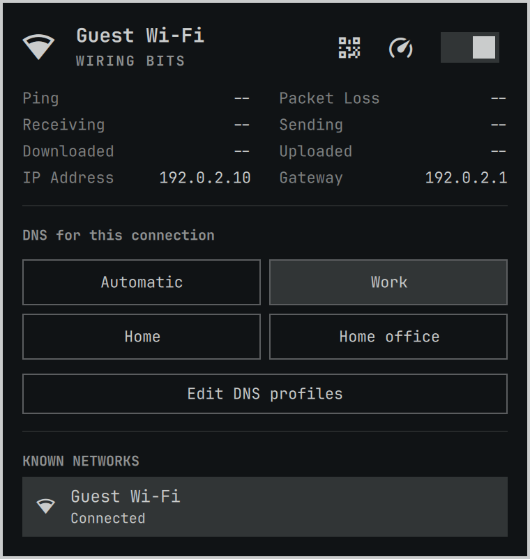
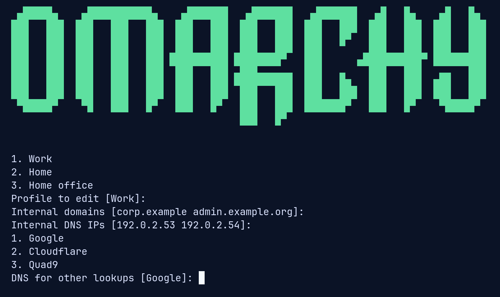

# oma-DNS-Work-Home-Configuration

Save DNS settings for individual Ethernet and Wi-Fi connections in the Omarchy network panel. Work can send internal domains or individual hostnames to an organization's resolver while sending other queries to a public DNS provider. NetworkManager remembers the settings by connection UUID, so two office Wi-Fi profiles can use different DNS servers.

## Screenshots

| Network panel with Work selected | Editing a saved Work profile |
| --- | --- |
| [](screenshots/network-panel.png) | [](screenshots/work-editor.png) |

The screenshots use an example connection and documentation-only addresses. Select either image to see it at full size.

## Install

Use an Omarchy Quattro desktop with the network panel, NetworkManager 1.44 or later, systemd-resolved, the resolved stub at `/etc/resolv.conf`, Python 3, PyGObject (Arch package `python-gobject`) and the NetworkManager introspection bindings (`libnm`). The QML plugin requires Quickshell's Networking module. Your desktop user needs permission to edit the selected NetworkManager profile. Administrator privileges are needed once to install the system DNS integration and again when updating or removing it.

Run this at a local terminal. The system setup reloads DNS and affects all users of this machine. Record any manually configured DNS servers and search domains you intend to restore later. For example, run `nmcli -f connection.id,connection.uuid,ipv4.dns,ipv4.dns-search,ipv4.ignore-auto-dns,ipv6.dns,ipv6.dns-search,ipv6.ignore-auto-dns connection show "Office Wi-Fi"`, substituting your actual connection name.

1. Download the plugin. Choose **No** if asked to enable it before setup.

   ```sh
   omarchy plugin add https://github.com/frank-blueview-ai/omarchy-network-dns
   cd ~/.config/omarchy/plugins/blueview.network-dns
   ```

2. Review `setup-system`, `network-dns` and the two configuration files alongside them. Then install the system integration.

   ```sh
   sudo ./setup-system install
   ```

3. Enable the network panel.

   ```sh
   omarchy plugin enable blueview.network-dns
   ```

This is a clone of the built-in network panel. Omarchy uses its clone relationship to replace the stock widget. If you use another customized network widget, check your bar layout and choose which one should handle the network panel shortcut.

## Choose a mode

Open the network panel and use **DNS for this connection**. If both Ethernet and Wi-Fi are connected, the plugin targets the connection shown in the panel. When it cannot identify one, it offers a connection picker.

| Mode | First selection | Later selections |
| --- | --- | --- |
| Automatic | Uses connection-supplied DNS immediately. A static connection without DNS may use system fallback. | Reapplies Automatic. |
| Work | Prompts for internal domains, internal DNS server IPs, and a provider for other lookups. DHCP suggestions can be edited. | Applies the saved configuration immediately. |
| Home | Offers Network DNS, Google, Cloudflare or Quad9. | Applies the saved Home choice. |
| Home office | Offers the same providers and keeps a separate choice for this mode. | Applies the saved Home office choice. |

**Edit DNS profiles** opens the editor for Work, Home or Home office. Press Enter to keep a displayed value. Editing the active mode applies it immediately. Editing another mode saves it for the next switch. Ctrl+C before saving cancels the edit. Previously configured Work connections can reuse their existing domains, servers and provider. Each new NetworkManager connection has its own first-time setup.

Work requires at least one internal DNS server whose IP family is enabled on the connection. If the panel no longer highlights Work after an IP family is disabled, open **Edit DNS profiles** and enter an internal resolver address for an enabled family.

### Example with an internal hostname and a public bookmark

Suppose `directory.corp.example` and `admin.example.org` identify the same internal service. The internal resolver also has an internal address for `admin.example.org`. A Work configuration could use:

| Prompt | Example |
| --- | --- |
| Internal domains | `corp.example admin.example.org` |
| Internal DNS IPs | `192.0.2.53 192.0.2.54` |
| DNS for other lookups | Google |

Replace these documentation-only names and addresses with your actual values. Enter names separated by spaces or commas. The plugin adds systemd-resolved's route-only prefix automatically. A route for `corp.example` covers its subdomains. Adding a single fully qualified hostname keeps the rest of its parent domain on the public resolver. Use the HTTPS hostname covered by the service's certificate. DNS selects the address and the application handles authentication.

## How DNS is applied

The desktop helper saves the active mode and mode-specific presets in the NetworkManager connection's user metadata. It sets that connection's IPv4 and IPv6 DNS settings and asks NetworkManager to reapply them. The Work preset stores your chosen public provider and the internal DNS server addresses locally. The plugin does not upload a profile.

The root-owned dispatcher runs on NetworkManager link, DHCP, VPN and reapply events. For Work it makes the internal domains route-only, removes conflicting live routes from other physical connections and selects the public resolver as a system-wide default for unmatched names. With two Work links the helper prefers the one carrying a default route. Home office relies on the VPN client to supply its own DNS servers and internal routes. A default-route VPN known to NetworkManager takes precedence over the plugin's public override. Clients managed outside NetworkManager can impose their own DNS policy.

| File | Purpose |
| --- | --- |
| `/usr/local/lib/omarchy-network-dns/network-dns` | Root-owned dispatcher helper. The panel runs its own copy as the desktop user. |
| `/etc/NetworkManager/dispatcher.d/90-omarchy-network-dns` | Reapplies routing following network changes. |
| `/etc/systemd/resolved.conf.d/94-omarchy-network-dns.conf` | Clears inherited global DNS and domain lists so connection settings can take effect. |
| `/run/systemd/resolved.conf.d/95-omarchy-work.conf` | Temporary default DNS for active Work connections. |
| `/var/lib/omarchy-network-dns/20-omarchy-dns.conf` | Backup of Omarchy's managed global NetworkManager DNS preset, if setup found one. |

Setup refuses to move an unrecognized global DNS file or overwrite the existing backup. Avoid selecting a machine-wide Omarchy DNS override while using per-connection profiles. The dispatcher uses a lock to serialize updates. A stale editor is rejected if NetworkManager reports that the connection changed underneath it. Open the editor again to work from the latest settings.

## Verify and troubleshoot

- Run `nmcli connection show --active` and `resolvectl status`. In Work mode the selected Ethernet or Wi-Fi link should list its internal DNS servers and the domains prefixed with `~`.
- Run `resolvectl query --cache=no your.internal.name`. If `dig` is installed, compare the result with `dig @YOUR_INTERNAL_DNS your.internal.name A +short`. A browser using a custom secure DNS provider or a proxy may follow a different resolution path.
- If the address is correct, test the application's URL with `curl -I https://your.internal.name/`. An HTTP 401 means the server is reachable and requests authentication. A certificate error needs the correct service hostname or certificate. Use the application's documented sign-in page if its integrated login fails.
- For **Limited access**, run `nmcli networking connectivity check`. NetworkManager uses a per-interface HTTP check to distinguish internet access from captive portals. Find the configured URL with `NetworkManager --print-config`. If ordinary browsing works, test its hostname with `resolvectl -i INTERFACE query PROBE_HOST`. On a split-DNS network, adding that exact hostname to Work's internal domains can let the interface-specific check succeed if the internal resolver can resolve it. The plugin uses Omarchy's existing connectivity test.
- If a save succeeds but reapplying fails, select the saved mode again or reconnect. Inspect `journalctl -b -u NetworkManager -u NetworkManager-dispatcher -u systemd-resolved` for local details.

## Update

Run `omarchy plugin update blueview.network-dns`. Review the update, then rerun `sudo ./setup-system install` from the installed plugin directory to update the root-owned helper as well. Saved presets belong to NetworkManager and survive plugin updates.

## Remove and restore DNS

1. For each connection you changed, select **Automatic** while connected or restore the manual DNS settings you recorded before installation. Automatic clears the plugin's explicit servers and DNS routes. For a disconnected profile use NetworkManager's connection editor to restore its IPv4 and IPv6 DNS settings before reusing it.
2. From the installed plugin directory, run `sudo ./setup-system remove`. It removes the dispatcher, helper and resolver overrides, restores the backed-up global preset when present, and reloads DNS. If a new global preset conflicts with the backup, the script stops before removing files so you can choose which global preset to keep.
3. Run `omarchy plugin remove blueview.network-dns`. Restore the stock widget with `omarchy plugin enable omarchy.network` if needed. User metadata with previously saved presets can remain in the NetworkManager profile for a future reinstall.
4. Check `resolvectl status` and `nmcli networking connectivity check` again.

## Test the helper

Run `/usr/bin/python3 -I tests/test_profiles.py` from the repository root with the same PyGObject and libnm dependencies. The tests use in-memory NetworkManager settings. They cover migration of older Work settings, independent Home choices, connection isolation, DHCP defaults, IPv6, editing, invalid input, and cancellation. For an installed system use the live verification commands above.

## License

Blue View's original additions in this repository use the PolyForm Noncommercial License 1.0.0. The original Omarchy network panel and model retain their MIT license. See [LICENSE](LICENSE), [upstream MIT terms](LICENSES/Omarchy-MIT.txt) and [NOTICE](NOTICE) for attribution and the scope of each grant.
